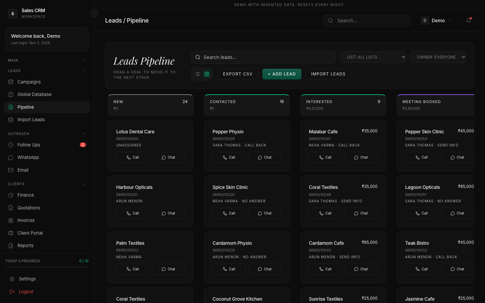
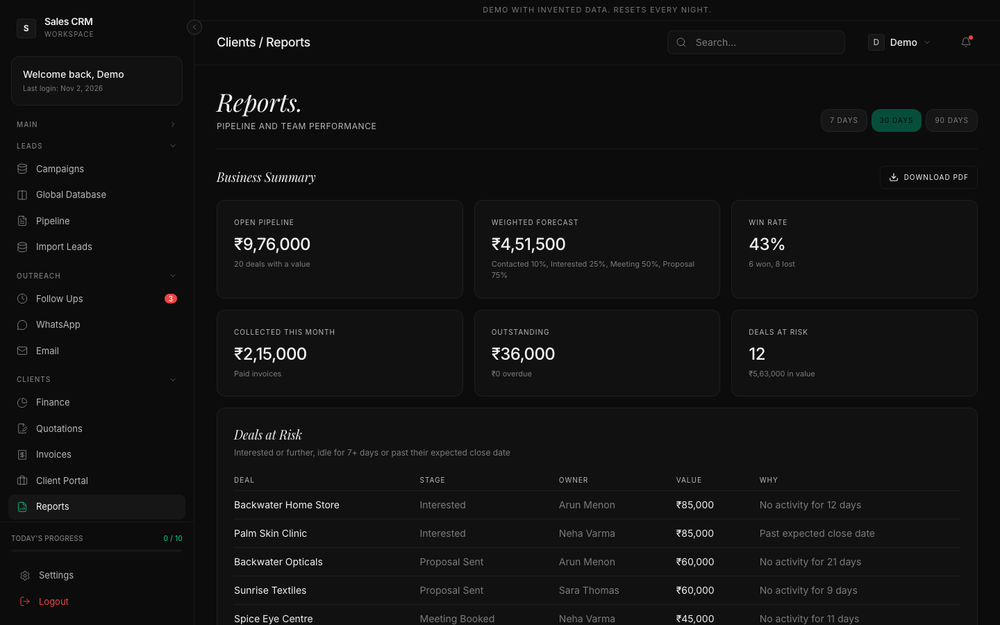
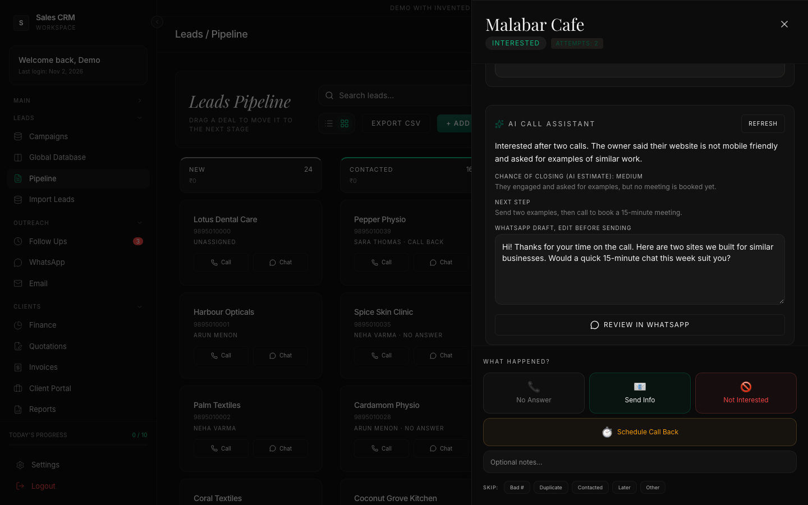
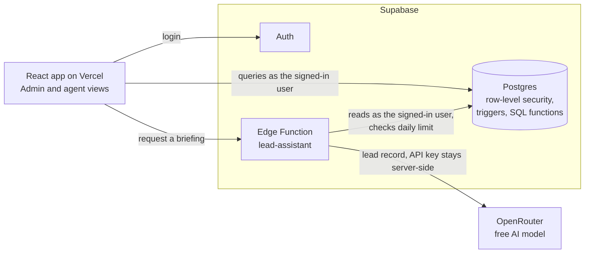

# Sales CRM

[](https://github.com/jasirjaleel/sales-crm/actions/workflows/ci.yml)

A sales CRM for a telecalling team: import leads, work a calling queue, move deals through a pipeline, and turn them into quotations, invoices and revenue.

**[Live demo](https://mysales-crm.vercel.app):** one click to log in as an owner or an agent, using invented data that resets every night.



## The problem

A small team cold-calling local businesses from spreadsheets loses track of who called whom, misses callbacks, and can't say what the pipeline is worth. This CRM gives agents one focused queue, and gives the owner one honest view of the business.

## What it does

| For agents | For the owner |
|---|---|
| A calling queue with one-tap call and WhatsApp | Pipeline value, weighted forecast and win rate |
| Call outcomes that schedule the follow-up automatically | Deals at risk, flagged by inactivity or a missed close date |
| An AI briefing and WhatsApp draft for each lead, reviewed before sending | Team performance and conversion funnel, with a PDF report |
| Quotations with a PDF, generated from the lead | Invoices and revenue tracking |
| Works on a phone | CSV import with duplicate detection, auto-assignment to daily targets |

| | |
|---|---|
|  |  |

All screenshots use invented data. The AI panel shows a sample briefing.

## Architecture



**Stack:** React 19, Vite, Tailwind CSS, Supabase (Postgres, Auth, Edge Functions), OpenRouter, Vitest, Playwright, GitHub Actions.

## Engineering decisions

**Access rules live in the database, not the UI.** The browser holds a public key, so hiding a button protects nothing. Row-level security policies decide what each user can read and write, and a trigger stops anyone promoting themselves to admin. `npm run test:security` proves this by attempting each attack with real logged-in sessions.

**Numbers are calculated in Postgres.** The API returns at most 1,000 rows per request by default, so totals calculated in the browser quietly go wrong as data grows. Dashboards call SQL functions instead, and the app is tested with 2,500+ leads.

**The pipeline moves itself where it safely can.** Triggers record every stage change, move a lead to Proposal Sent when its quotation goes out, and to Won when its invoice is paid. Doing this in the database means the rules hold however the data changes, and history can't be forged from the browser.

**AI drafts, people send.** The assistant only reads a lead the signed-in user can already access, so access rules apply to it too. Lead notes are treated as untrusted data in the prompt. Nothing is sent automatically: the agent edits the draft and sends it from their own WhatsApp. Answers are checked against the expected format before anyone sees them, and each user has a daily request limit.

**The demo can't touch real data.** The script that resets the demo wipes its database, so it refuses to run unless that database carries an explicit demo marker.

## Testing

| Command | What it covers |
|---|---|
| `npm test` | Column mapping, phone formats, WhatsApp links, CSV safety, stage logic |
| `npm run test:security` | Access rules, using real admin and agent sessions |
| `npm run test:e2e` | The main flows in a real browser, including mouse drag-and-drop and mobile |

All of them, plus lint and a dependency audit, run on every pull request.

## Run it locally

Requires Node and Docker. Nothing here touches production.

```bash
npm install
npx supabase start
npx supabase db reset
node scripts/seed-local.mjs
```

Copy `.env.example` to `.env.local`, fill it from `npx supabase status`, then run `npm run dev`. Local logins are in `scripts/seed-local.mjs`.

For the AI assistant, put `OPENROUTER_API_KEY` in an env file and run `npx supabase functions serve --env-file <file>`.

## Deployment

Database changes live in `supabase/migrations/`. `20260731000000_baseline.sql` describes the original schema and is **not** run on production, which already has it. Take a backup, run the newer files in order, then deploy the app straight after.

- **Auth settings:** keep public sign-ups off and invite users instead. Add `https://<your-domain>/login` to the redirect allow list, or password reset links will fail.
- **App:** set `VITE_SUPABASE_URL` and `VITE_SUPABASE_ANON_KEY` on the hosting platform, plus the `VITE_BRAND_*` values from `.env.example`. They set the business name and the details printed on quotations and invoices.
- **AI assistant:** run `npx supabase functions deploy lead-assistant` and `npx supabase secrets set OPENROUTER_API_KEY=...`. `AI_DAILY_LIMIT_PER_USER` defaults to 50, and `OPENROUTER_MODEL` defaults to `openrouter/free`. Free providers may log prompts, so use a paid, no-logging model before sending real customer data.

### Public demo

Use a **separate** Supabase project, never production.

1. Run the migrations on it, then `supabase/demo/mark-demo.sql`.
2. Turn off public sign-ups there too.
3. Deploy the app as a separate Vercel project with `VITE_DEMO_MODE=true` and `VITE_DEMO_PASSWORD=<demo password>`, plus that project's Supabase URL and anon key. The demo password is public by design.
4. In GitHub, add the secrets `DEMO_SUPABASE_URL`, `DEMO_SERVICE_ROLE_KEY` and `DEMO_PASSWORD`, and set the variable `DEMO_ENABLED=true` to turn on the nightly reset.
5. If you enable the AI assistant there, set a low `AI_DAILY_LIMIT_PER_USER`, because everyone shares the demo logins.
